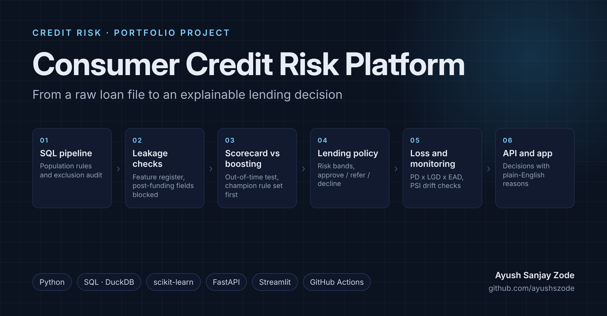

# Consumer Credit Risk Platform

[](https://github.com/ayushszode/consumer-credit-risk-platform/actions/workflows/ci.yml)



**Live demo:** [ayushszode-credit-risk.streamlit.app](https://ayushszode-credit-risk.streamlit.app) (runs on synthetic data until the full LendingClub results are added; the app says so on every page)

End-to-end consumer credit risk project using **Python, SQL and scikit-learn** on public LendingClub
loan data. It goes from a raw loan file to a lending decision: an explainable scorecard, a challenger
model, approve / refer / decline cut-offs, expected loss, monitoring, and a small API and app to score
one applicant at a time.

## Business objective

A lender needs to decide who to lend to, and it has to be able to explain each decision to the
customer, a credit committee and a regulator. This project asks:

1. Which information known at the time of application best separates loans that are repaid from
   loans that default?
2. Does a gradient boosting model rank applicants clearly better than a traditional points-based
   scorecard, or is the simpler model good enough?
3. If a lender had used the model on 36-month loans in 2015, how many could it have approved
   automatically, and how many of those would have defaulted?
4. How much should it have expected to lose on those loans?
5. How would the lender know if the model started to drift?

## Dataset

**LendingClub accepted loans, 2007 to 2018 Q4** (Kaggle: "All Lending Club loan data")

- Loans used: 36-month, individual applications issued **January 2012 to December 2015** that ended
  as Fully Paid, Charged Off or Default
- Target: `1` if the loan charged off or defaulted at any point in its term, `0` if fully paid
- Split by issue date: **train 2012 to 2013, validation 2014, test 2015**

Raw data is not committed to this repository. See [`data/README.md`](data/README.md) and
[`DATA_LICENSE_NOTICE.md`](DATA_LICENSE_NOTICE.md).

## Results

_The full run on the real data has not been done yet. This section will hold the verified numbers:
population size, test-year AUC / Gini / KS and calibration for each model, the champion decision,
the share of 2015 loans approved automatically and their default rate, and expected loss. Until then,
`make demo` runs the whole pipeline on synthetic data to show it works._

<!-- Every number added here must come from reports/results/ after `make run`. -->

## Modelling approach

### Data preparation (SQL)

- DuckDB reads the compressed file directly and cleans every column with `TRY_CAST`, so one bad
  value does not stop the load
- Population rules are applied in a fixed order, and the number of loans removed by each rule is
  saved (`population_audit.csv`)
- A pandas version of the same rules runs if DuckDB is not installed, and a test checks both give
  the same result

### Leakage control

Every column in the file is listed in a feature register as *use*, *benchmark only*, *exclude:
leakage* or *needs review*. Anything only known after a loan was funded (payments, recoveries, last
payment date, later credit scores) is blocked, and the pipeline stops if one gets into a model.

### Scorecard (main model)

- Weight-of-evidence binning on the training years only
- Features kept if Information Value is at least 0.02 and they are not highly correlated (above
  0.70) with a stronger feature
- Logistic regression, then points: **600 points at odds of 20 to 1, 20 points to double the odds**
- Reason codes come from where an applicant loses the most points

### Challenger and benchmark

- **Gradient boosting** (`HistGradientBoostingClassifier`) on the same features, tuned on 2014
- **Benchmark**: the same model also given LendingClub's own grade and interest rate, to show how
  close an independent model gets to the lender's own view. It is never a candidate for use

### Champion rule (set before scoring 2015)

Boosting replaces the scorecard only if it improves test AUC by at least **0.01**, the 95% confidence
interval for the gain (paired bootstrap on the same loans) is above zero, and its calibration slope
stays between **0.8 and 1.2**.

### Lending policy and loss

```text
Risk bands:  A <= 6%   B <= 10%   C <= 15%   D <= 22%   E above 22%   (predicted PD)
Decision:    approve if PD <= 12%   decline if PD >= 25%   otherwise refer
Expected loss = PD x LGD x EAD
```

LGD and EAD are measured on charged-off training loans, with a sensitivity table for other values.
This is a lifetime expected loss, not an IFRS 9 calculation.

### Monitoring

Population Stability Index for the score and every feature (0.10 investigate, 0.25 act), a
quarter-by-quarter replay of 2014 and 2015, and default rates by vintage.

### Explanations

Each decision comes with a plain-English reason built from a template, for example:

> Your application has been declined. Our model puts it in risk band E. The main things that raised
> the estimated risk were a credit score of 677, 78% of available revolving credit in use and a
> debt-to-income ratio of 31%.

An optional language-model rewrite is off by default. If it changes a number, the outcome, or
mentions a protected topic, it is thrown away and the template is used.

## Repository structure

```text
consumer-credit-risk-platform/
├── README.md
├── START_HERE.md
├── DATA_LICENSE_NOTICE.md
├── LICENSE
├── Makefile
├── requirements.txt / requirements-dev.txt / constraints.txt
├── configs/
│   └── base.yaml                  # every threshold and setting in one place
├── sql/
│   ├── 01_clean.sql
│   ├── 02_population.sql
│   └── 03_features.sql
├── src/credit_risk/
│   ├── data.py  features.py  quality.py
│   ├── scorecard.py  models.py  evaluate.py
│   ├── policy.py  pricing.py  monitoring.py  experiment.py
│   ├── explain.py  service.py  figures.py
│   ├── synthetic.py               # fake loans for tests and the demo
│   └── pipeline.py                # runs everything
├── api/
│   └── main.py                    # FastAPI: /health, /score
├── app/
│   └── streamlit_app.py           # 5-page app
├── tests/                         # 41 tests, synthetic data only
├── examples/
│   └── applicant.json
├── reports/
│   ├── model_development.md  validation_review.md  policy_analysis.md
│   ├── experiment_design.md  governance_mapping.md
│   ├── limitations.md  decision_log.md
│   └── results.md, results/, figures/   # generated by the pipeline
├── images/
│   └── cover.png
├── docs/
│   ├── case_study.md  interview_guide.md  data_dictionary.md
│   ├── linkedin_entry.md  cv_bullets.md  github_setup.md
├── data/
│   ├── README.md
│   ├── raw/                       # downloaded locally; excluded from Git
│   └── processed/                 # excluded from Git
└── artifacts/                     # trained model, generated locally
```

## How to run

```bash
conda create -n credit-risk python=3.12 -y
conda activate credit-risk
make setup        # install requirements and the package
make test         # 41 tests on synthetic data
make demo         # whole pipeline on synthetic data, under a minute
```

With the real file in `data/raw/`:

```bash
make sample       # 20% of the loans, for a quick check
make run          # everything
```

Then:

```bash
make api          # http://127.0.0.1:8000/docs
curl -X POST http://127.0.0.1:8000/score -H "Content-Type: application/json" -d @examples/applicant.json
make app          # Streamlit app in the browser
```

See [`START_HERE.md`](START_HERE.md) for the same steps one at a time.

## Reports

| Report | What it covers |
|---|---|
| [`model_development.md`](reports/model_development.md) | Data, population rules, features and models |
| [`validation_review.md`](reports/validation_review.md) | The model checked as a validator would, with open questions |
| [`policy_analysis.md`](reports/policy_analysis.md) | Bands, cut-offs, approval rates and expected loss |
| [`experiment_design.md`](reports/experiment_design.md) | How champion and challenger would be tested live |
| [`governance_mapping.md`](reports/governance_mapping.md) | PRA SS1/23, FCA Consumer Duty and IFRS 9 in plain terms |
| [`limitations.md`](reports/limitations.md) | What this project cannot tell you |
| [`decision_log.md`](reports/decision_log.md) | The main decisions and why |

## Limitations

- US online lender, 2012 to 2018. UK lenders use different bureau data, affordability rules and
  products, so the model itself would not transfer; the method would.
- Accepted loans only. Nobody LendingClub declined is in the data, so the model is likely too
  optimistic about applicants like them.
- The target is a lifetime default flag, not a 12-month PD, and expected loss is not IFRS 9.
- LGD and EAD are single averages, not models.
- Monitoring is a replay on past data, not live.
- This is a portfolio and learning project, not a production lending system.

## What I would do next

- Model *when* loans default (a survival model) to get a 12-month PD
- Replace the single LGD with a model that varies by loan
- Check outcomes across groups, carefully, using the proxies available
- Try the same pipeline on UK data if a suitable public dataset becomes available

## Skills demonstrated

**Credit Risk | Scorecards | Python | SQL | DuckDB | scikit-learn | Logistic Regression | Gradient
Boosting | Model Validation | Calibration | Monitoring (PSI) | Expected Loss | FastAPI | Streamlit |
Testing | GitHub Actions**

---

Ayush Sanjay Zode · [LinkedIn](https://www.linkedin.com/in/ayushsanjayzode) ·
[Portfolio](https://ayushszode-portfolio-nm22.vercel.app/) · [GitHub](https://github.com/ayushszode)
